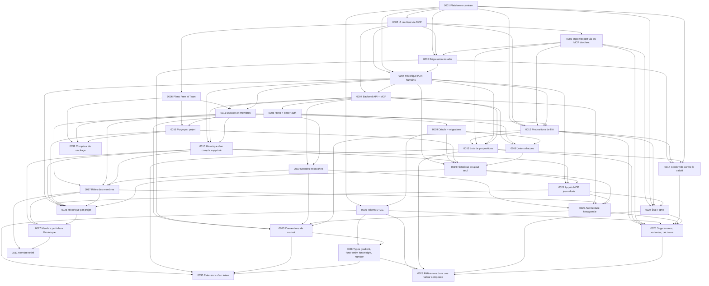

# Décisions d'architecture

Format et circuit : voir [`.claude/rules/adr-et-spikes.md`](../../.claude/rules/adr-et-spikes.md).

## Index

| ADR                                                                                                          | Décision                                                                                                                      | Statut                                                                                                                                                                                                                                                                                    |
| ------------------------------------------------------------------------------------------------------------ | ----------------------------------------------------------------------------------------------------------------------------- | ----------------------------------------------------------------------------------------------------------------------------------------------------------------------------------------------------------------------------------------------------------------------------------------- |
| [0001](0001-plateforme-centrale-de-design-plutot-que-pont-figma-code.md)                                     | Plateforme centrale de design pensée pour l'IA plutôt que pont Figma → code                                                   | Accepté                                                                                                                                                                                                                                                                                   |
| [0002](0002-ia-du-client-via-mcp-sans-ia-embarquee.md)                                                       | L'IA du client lit et écrit via le MCP de la plateforme, sans IA embarquée                                                    | Accepté                                                                                                                                                                                                                                                                                   |
| [0003](0003-import-export-orchestres-par-les-mcp-du-client.md)                                               | Import et export Figma ou repo orchestrés par l'IA du client via ses MCP, sans intégration d'API tierce                       | Accepté                                                                                                                                                                                                                                                                                   |
| [0004](0004-historique-unique-des-actions-de-l-ia-et-des-humains.md)                                         | Historique unique des actions de l'IA et des humains pour le suivi, l'auto-correction et l'audit                              | Accepté — §5 remplacé par [0015](0015-l-historique-garde-les-actions-d-un-compte-supprime-sous-un-membre-supprime.md) ; §1 remplacé par [0021](0021-seuls-les-appels-mcp-qui-visent-un-espace-ou-un-projet-entrent-dans-l-historique.md)                                                  |
| [0005](0005-regression-visuelle-des-snapshots-envoyes-par-la-ci.md)                                          | Régression visuelle des composants à partir des snapshots envoyés par la CI, comparés au design et au dernier snapshot validé | Accepté — §2 et §4 remplacés par [0014](0014-la-conformite-se-mesure-contre-la-version-validee-d-un-composant.md)                                                                                                                                                                         |
| [0006](0006-plans-free-et-team-mcp-complet-dans-tous-les-plans.md)                                           | Plan Free à 3 projets et 500 Mo, plan Team à 34,99 €/mois et 20 Go, MCP complet dans tous les plans                           | Accepté — portée des limites et §2 remplacés par [0011](0011-l-espace-possede-les-projets-et-porte-le-plan.md) ; §4 remplacé par [0016](0016-la-purge-d-un-espace-commence-par-le-projet-qui-consomme-le-plus.md)                                                                         |
| [0007](0007-un-seul-backend-api-et-mcp-streamable-http-oauth.md)                                             | Un seul backend qui expose l'API HTTP et le MCP en Streamable HTTP, authentifié par OAuth 2.1                                 | Accepté — limites par utilisateur remplacées par [0011](0011-l-espace-possede-les-projets-et-porte-le-plan.md)                                                                                                                                                                            |
| [0008](0008-hono-pour-le-backend-better-auth-pour-l-authentification.md)                                     | Hono pour le backend, better-auth pour l'authentification et le serveur OAuth du MCP                                          | Accepté                                                                                                                                                                                                                                                                                   |
| [0009](0009-drizzle-pour-postgresql-migrations-hors-demarrage.md)                                            | Drizzle ORM pour PostgreSQL, migrations appliquées par `migrator` hors du démarrage de l'app                                  | Accepté                                                                                                                                                                                                                                                                                   |
| [0010](0010-tokens-au-format-dtcg-modes-par-le-resolver.md)                                                  | Tokens de design au format DTCG, modes décrits par le module Resolver                                                         | Accepté                                                                                                                                                                                                                                                                                   |
| [0011](0011-l-espace-possede-les-projets-et-porte-le-plan.md)                                                | L'espace possède les projets et porte le plan, ses membres sont propriétaires ou éditeurs                                     | Accepté — auteur d'un compte supprimé remplacé par [0015](0015-l-historique-garde-les-actions-d-un-compte-supprime-sous-un-membre-supprime.md)                                                                                                                                            |
| [0012](0012-les-ecritures-de-l-ia-sont-des-propositions-relues-par-un-editeur.md)                            | Les écritures de l'IA sont des propositions, relues par lot et validées ou rejetées par un éditeur                            | Accepté — §4 remplacé et §1 complété par [0013](0013-lots-de-propositions-declares-par-l-ia-propositions-remplacees-et-ecritures-identiques.md) ; §1, §2 et §5 remplacés par [0026](0026-suppressions-ecritures-des-membres-variantes-et-decisions-dans-la-relecture-des-propositions.md) |
| [0013](0013-lots-de-propositions-declares-par-l-ia-propositions-remplacees-et-ecritures-identiques.md)       | Lots de propositions déclarés par l'IA, propositions remplacées et écritures identiques                                       | Accepté — §6 et §8 complétés par [0026](0026-suppressions-ecritures-des-membres-variantes-et-decisions-dans-la-relecture-des-propositions.md)                                                                                                                                             |
| [0014](0014-la-conformite-se-mesure-contre-la-version-validee-d-un-composant.md)                             | La conformité se mesure contre la version validée d'un composant                                                              | Accepté                                                                                                                                                                                                                                                                                   |
| [0015](0015-l-historique-garde-les-actions-d-un-compte-supprime-sous-un-membre-supprime.md)                  | L'historique garde les actions d'un compte supprimé sous un membre supprimé pseudonyme                                        | Accepté — §2 remplacé par [0027](0027-un-membre-parti-reste-nomme-dans-l-historique-de-chaque-projet-de-l-espace.md)                                                                                                                                                                      |
| [0016](0016-la-purge-d-un-espace-commence-par-le-projet-qui-consomme-le-plus.md)                             | La purge d'un espace commence par le projet qui consomme le plus                                                              | Accepté                                                                                                                                                                                                                                                                                   |
| [0017](0017-les-roles-des-membres-vivent-dans-une-table-de-l-espace-evalues-par-une-fonction-pure.md)        | Les rôles des membres vivent dans une table de l'espace et sont évalués par une fonction pure                                 | Accepté — §2 complété par [0031](0031-un-membre-retire-par-un-proprietaire-est-ferme-avec-la-raison-removed.md)                                                                                                                                                                           |
| [0018](0018-jetons-d-acces-jwt-lies-a-l-api-session-verifiee-en-base-a-chaque-appel.md)                      | Jetons d'accès JWT liés à l'API, session vérifiée en base à chaque appel                                                      | Accepté                                                                                                                                                                                                                                                                                   |
| [0019](0019-l-historique-est-en-ajout-seul-pour-l-app-la-purge-passe-par-un-role-dedie.md)                   | L'historique est en ajout seul pour l'app ; la purge passe par un rôle dédié                                                  | Accepté — §2 complété par [0025](0025-l-historique-appartient-au-projet-un-espace-n-en-a-pas.md)                                                                                                                                                                                          |
| [0020](0020-modules-et-couches-de-l-api-imposes-par-des-regles-oxlint.md)                                    | Modules et couches de l'API imposés par des règles oxlint                                                                     | Accepté                                                                                                                                                                                                                                                                                   |
| [0021](0021-seuls-les-appels-mcp-qui-visent-un-espace-ou-un-projet-entrent-dans-l-historique.md)             | Seuls les appels MCP qui visent un espace ou un projet entrent dans l'historique                                              | Accepté — §1 remplacé par [0025](0025-l-historique-appartient-au-projet-un-espace-n-en-a-pas.md)                                                                                                                                                                                          |
| [0022](0022-architecture-hexagonale-a-coeur-fonctionnel-pour-le-backend.md)                                  | Architecture hexagonale à cœur fonctionnel pour le backend                                                                    | Accepté                                                                                                                                                                                                                                                                                   |
| [0023](0023-reponses-ouvertes-enums-ouverts-et-unions-extensibles-dans-les-contrats.md)                      | Réponses ouvertes, enums ouverts et unions extensibles dans les contrats                                                      | Accepté                                                                                                                                                                                                                                                                                   |
| [0024](0024-l-etat-figma-d-un-token-est-declare-par-l-ia-du-client.md)                                       | L'état Figma d'un token est déclaré par l'IA du client                                                                        | Accepté — §4 complété par [0026](0026-suppressions-ecritures-des-membres-variantes-et-decisions-dans-la-relecture-des-propositions.md)                                                                                                                                                    |
| [0025](0025-l-historique-appartient-au-projet-un-espace-n-en-a-pas.md)                                       | L'historique appartient au projet ; un espace n'en a pas                                                                      | Accepté                                                                                                                                                                                                                                                                                   |
| [0026](0026-suppressions-ecritures-des-membres-variantes-et-decisions-dans-la-relecture-des-propositions.md) | Suppressions, écritures des membres, variantes et décisions dans la relecture des propositions                                | Accepté                                                                                                                                                                                                                                                                                   |
| [0027](0027-un-membre-parti-reste-nomme-dans-l-historique-de-chaque-projet-de-l-espace.md)                   | Un membre parti reste nommé dans l'historique de chaque projet de l'espace                                                    | Accepté — §2 complété par [0031](0031-un-membre-retire-par-un-proprietaire-est-ferme-avec-la-raison-removed.md)                                                                                                                                                                           |
| [0028](0028-types-de-token-gradient-fontfamily-fontweight-et-number.md)                                      | Types de token `gradient`, `fontFamily`, `fontWeight` et `number`                                                             | Accepté                                                                                                                                                                                                                                                                                   |
| [0029](0029-un-champ-d-une-valeur-composee-peut-referencer-un-token.md)                                      | Un champ d'une valeur composée peut référencer un token                                                                       | Accepté                                                                                                                                                                                                                                                                                   |
| [0030](0030-dezyn-conserve-les-extensions-d-un-token-sans-les-interpreter.md)                                | dezyn conserve les extensions d'un token sans les interpréter                                                                 | Accepté                                                                                                                                                                                                                                                                                   |
| [0031](0031-un-membre-retire-par-un-proprietaire-est-ferme-avec-la-raison-removed.md)                        | Un membre retiré par un propriétaire est fermé avec la raison `removed`, et l'historique le dit parti                         | Accepté                                                                                                                                                                                                                                                                                   |
| [0032](0032-le-stockage-d-un-projet-se-compte-par-un-compteur-d-octets-tenu-a-chaque-ecriture.md)            | Le stockage d'un projet se compte par un compteur d'octets tenu à chaque écriture                                             | Proposé                                                                                                                                                                                                                                                                                   |

## Dépendances principales

## Points ouverts

- La confirmation du seuil par défaut 0,1 / 0,1 % sur de vrais composants (ADR 0005, [spike](../spikes/2026-10-14-seuil-de-regression-visuelle.md)).
- Les chantiers et les sélections, issus de l'outil de sélections d'Axel, ne sont pas tranchés (synthèse §6). Le partage d'une direction artistique entre projets est écarté pour l'instant (ADR 0011 §2).
- Le rappel à l'éditeur quand une variante reste sans version validée (ADR 0014, risques).
- Le contenu d'une entrée d'historique qui contient une donnée personnelle d'un compte supprimé (ADR 0015, risques).
- La mention « a quitté l'espace » pour un membre parti puis réinvité (ADR 0027, risques).
- La mention « a quitté l'espace » sur les entrées de l'IA autorisée par un membre parti (ADR 0027, risques).
- La valeur du champ `version` acceptée à l'import d'un fichier Resolver, que le module contredit (ADR 0010, risques).
- L'export vers les outils qui ne lisent pas encore le module Resolver (ADR 0010, risques).
- Les types `duration`, `cubicBezier`, `transition`, `border` et `strokeStyle`, qui attendent un import qui en contient (ADR 0028 §3).
- La détection des doublons parmi les typographies et les ombres dont les champs sont des alias (ADR 0029, négatives).
- L'exclusion éventuelle de clés changeantes de l'écriture identique (ADR 0030, risques).
