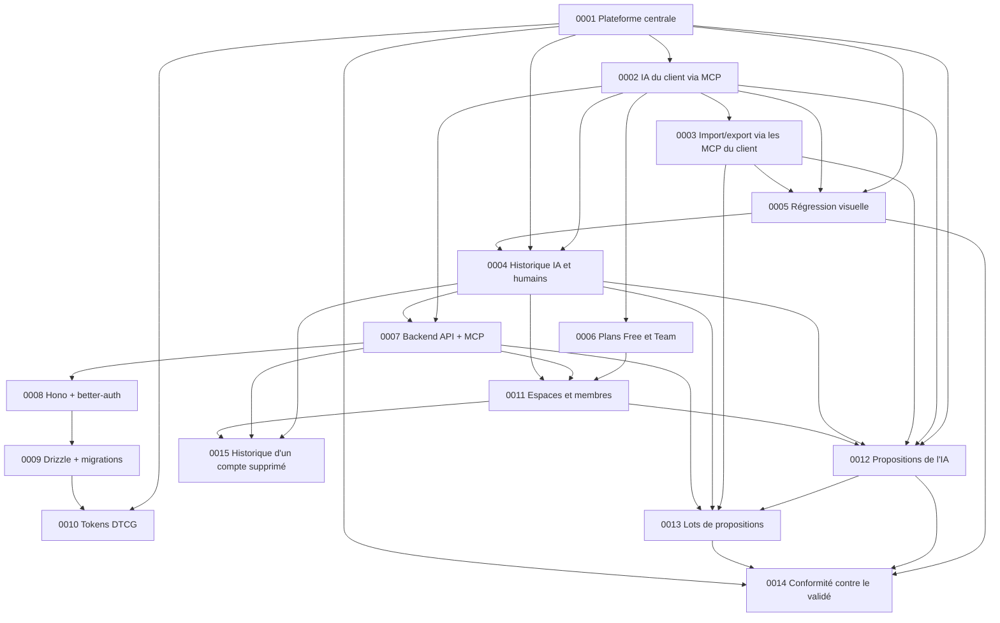

# Décisions d'architecture

Format et circuit : voir [`.claude/rules/adr-et-spikes.md`](../../.claude/rules/adr-et-spikes.md).

## Index

| ADR                                                                                                    | Décision                                                                                                                      | Statut                                                                                                                                          |
| ------------------------------------------------------------------------------------------------------ | ----------------------------------------------------------------------------------------------------------------------------- | ----------------------------------------------------------------------------------------------------------------------------------------------- |
| [0001](0001-plateforme-centrale-de-design-plutot-que-pont-figma-code.md)                               | Plateforme centrale de design pensée pour l'IA plutôt que pont Figma → code                                                   | Accepté                                                                                                                                         |
| [0002](0002-ia-du-client-via-mcp-sans-ia-embarquee.md)                                                 | L'IA du client lit et écrit via le MCP de la plateforme, sans IA embarquée                                                    | Accepté                                                                                                                                         |
| [0003](0003-import-export-orchestres-par-les-mcp-du-client.md)                                         | Import et export Figma ou repo orchestrés par l'IA du client via ses MCP, sans intégration d'API tierce                       | Accepté                                                                                                                                         |
| [0004](0004-historique-unique-des-actions-de-l-ia-et-des-humains.md)                                   | Historique unique des actions de l'IA et des humains pour le suivi, l'auto-correction et l'audit                              | Accepté — §5 remplacé par [0015](0015-l-historique-garde-les-actions-d-un-compte-supprime-sous-un-membre-supprime.md)                           |
| [0005](0005-regression-visuelle-des-snapshots-envoyes-par-la-ci.md)                                    | Régression visuelle des composants à partir des snapshots envoyés par la CI, comparés au design et au dernier snapshot validé | Accepté — §2 et §4 remplacés par [0014](0014-la-conformite-se-mesure-contre-la-version-validee-d-un-composant.md)                               |
| [0006](0006-plans-free-et-team-mcp-complet-dans-tous-les-plans.md)                                     | Plan Free à 3 projets et 500 Mo, plan Team à 34,99 €/mois et 20 Go, MCP complet dans tous les plans                           | Accepté — portée des limites et §2 remplacés par [0011](0011-l-espace-possede-les-projets-et-porte-le-plan.md)                                  |
| [0007](0007-un-seul-backend-api-et-mcp-streamable-http-oauth.md)                                       | Un seul backend qui expose l'API HTTP et le MCP en Streamable HTTP, authentifié par OAuth 2.1                                 | Accepté — limites par utilisateur remplacées par [0011](0011-l-espace-possede-les-projets-et-porte-le-plan.md)                                  |
| [0008](0008-hono-pour-le-backend-better-auth-pour-l-authentification.md)                               | Hono pour le backend, better-auth pour l'authentification et le serveur OAuth du MCP                                          | Accepté                                                                                                                                         |
| [0009](0009-drizzle-pour-postgresql-migrations-hors-demarrage.md)                                      | Drizzle ORM pour PostgreSQL, migrations appliquées par `migrator` hors du démarrage de l'app                                  | Accepté                                                                                                                                         |
| [0010](0010-tokens-au-format-dtcg-modes-par-le-resolver.md)                                            | Tokens de design au format DTCG, modes décrits par le module Resolver                                                         | Accepté                                                                                                                                         |
| [0011](0011-l-espace-possede-les-projets-et-porte-le-plan.md)                                          | L'espace possède les projets et porte le plan, ses membres sont propriétaires ou éditeurs                                     | Accepté — auteur d'un compte supprimé remplacé par [0015](0015-l-historique-garde-les-actions-d-un-compte-supprime-sous-un-membre-supprime.md)  |
| [0012](0012-les-ecritures-de-l-ia-sont-des-propositions-relues-par-un-editeur.md)                      | Les écritures de l'IA sont des propositions, relues par lot et validées ou rejetées par un éditeur                            | Accepté — §4 remplacé et §1 complété par [0013](0013-lots-de-propositions-declares-par-l-ia-propositions-remplacees-et-ecritures-identiques.md) |
| [0013](0013-lots-de-propositions-declares-par-l-ia-propositions-remplacees-et-ecritures-identiques.md) | Lots de propositions déclarés par l'IA, propositions remplacées et écritures identiques                                       | Accepté                                                                                                                                         |
| [0014](0014-la-conformite-se-mesure-contre-la-version-validee-d-un-composant.md)                       | La conformité se mesure contre la version validée d'un composant                                                              | Accepté                                                                                                                                         |
| [0015](0015-l-historique-garde-les-actions-d-un-compte-supprime-sous-un-membre-supprime.md)            | L'historique garde les actions d'un compte supprimé sous un membre supprimé pseudonyme                                        | Accepté                                                                                                                                         |

## Dépendances principales

## Points ouverts

- La confirmation du seuil par défaut 0,1 / 0,1 % sur de vrais composants (ADR 0005, [spike](../spikes/2026-10-14-seuil-de-regression-visuelle.md)).
- Les chantiers et les sélections, issus de l'outil de sélections d'Axel, ne sont pas tranchés (synthèse §6). Le partage d'une direction artistique entre projets est écarté pour l'instant (ADR 0011 §2).
- Le rappel à l'éditeur quand une variante reste sans version validée (ADR 0014, risques).
- Le contenu d'une entrée d'historique qui contient une donnée personnelle d'un compte supprimé (ADR 0015, risques).
