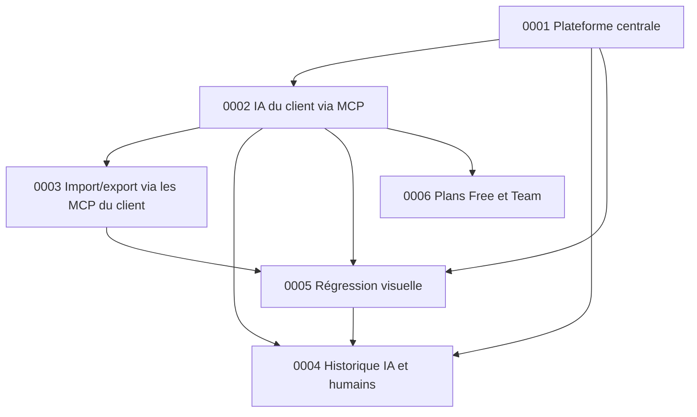

# Décisions d'architecture

Format et circuit : voir [`.claude/rules/adr-et-spikes.md`](../../.claude/rules/adr-et-spikes.md).

## Index

| ADR                                                                      | Décision                                                                                                                      | Statut  |
| ------------------------------------------------------------------------ | ----------------------------------------------------------------------------------------------------------------------------- | ------- |
| [0001](0001-plateforme-centrale-de-design-plutot-que-pont-figma-code.md) | Plateforme centrale de design pensée pour l'IA plutôt que pont Figma → code                                                   | Proposé |
| [0002](0002-ia-du-client-via-mcp-sans-ia-embarquee.md)                   | L'IA du client lit et écrit via le MCP de la plateforme, sans IA embarquée                                                    | Proposé |
| [0003](0003-import-export-orchestres-par-les-mcp-du-client.md)           | Import et export Figma ou repo orchestrés par l'IA du client via ses MCP, sans intégration d'API tierce                       | Proposé |
| [0004](0004-historique-unique-des-actions-de-l-ia-et-des-humains.md)     | Historique unique des actions de l'IA et des humains pour le suivi, l'auto-correction et l'audit                              | Proposé |
| [0005](0005-regression-visuelle-des-snapshots-envoyes-par-la-ci.md)      | Régression visuelle des composants à partir des snapshots envoyés par la CI, comparés au design et au dernier snapshot validé | Proposé |
| [0006](0006-plans-free-et-team-mcp-complet-dans-tous-les-plans.md)       | Plan Free à 3 projets et 500 Mo, plan Team à 34,99 €/mois et 20 Go, MCP complet dans tous les plans                           | Proposé |

## Dépendances principales

## Points ouverts

- La confirmation du seuil par défaut 0,1 / 0,1 % sur de vrais composants (ADR 0005, [spike](../spikes/2026-10-14-seuil-de-regression-visuelle.md)).
- Le modèle DA → projets → chantiers → sélections, issu de l'outil de sélections d'Axel, n'est pas tranché (synthèse §6).
